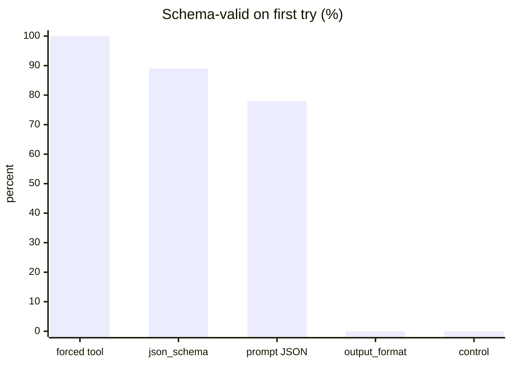
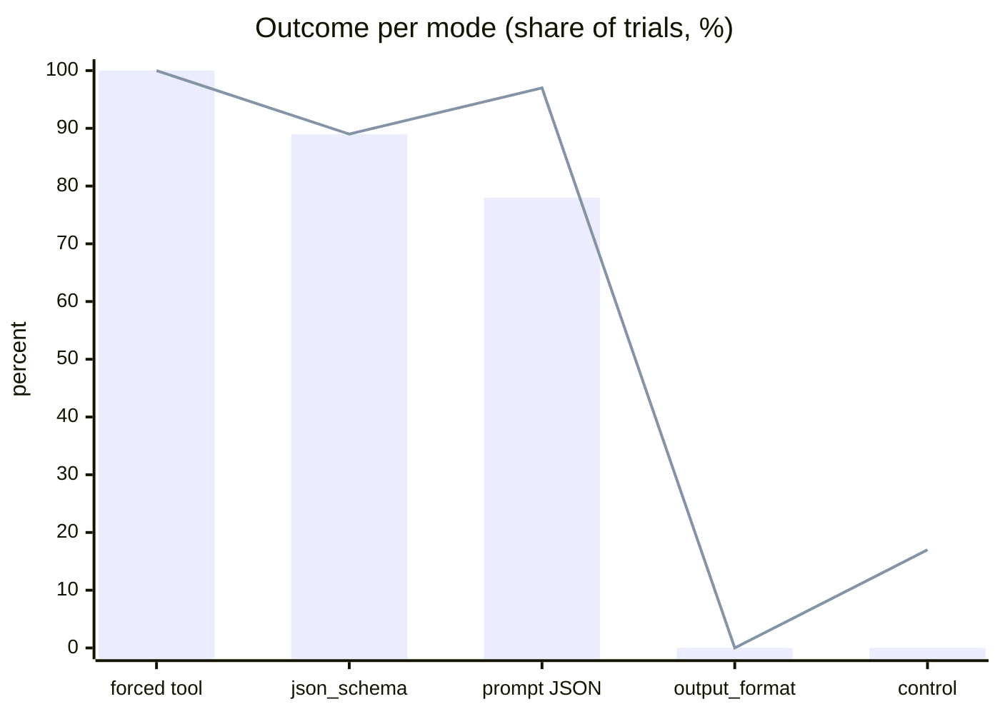
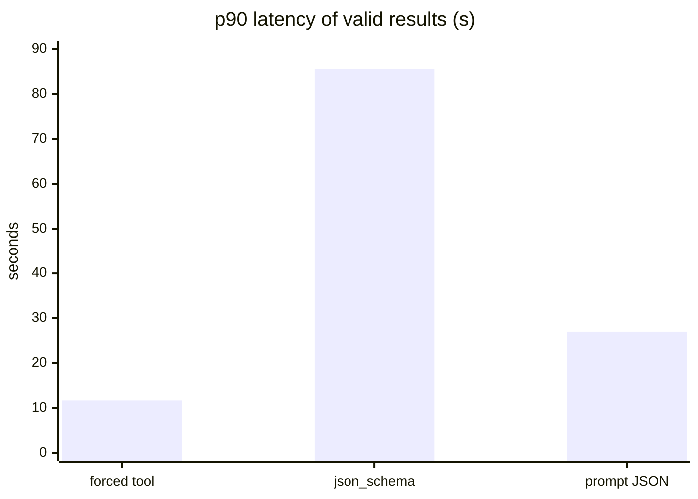
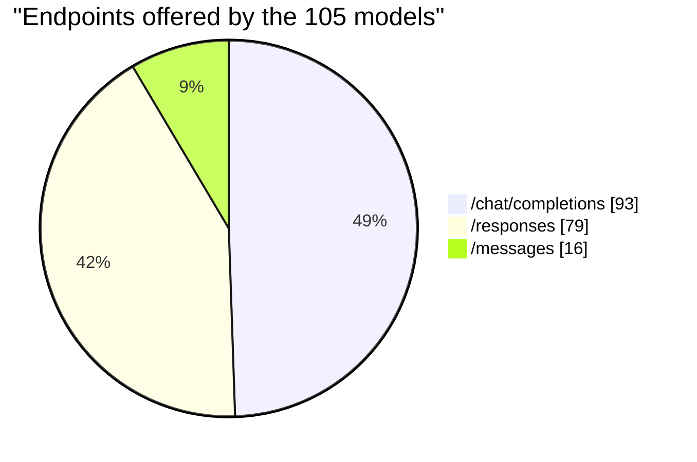
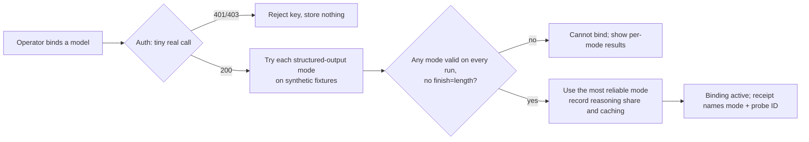

# Spikes

A **spike** is a time-boxed, throwaway experiment that answers one technical question before the
product depends on the answer. Its code lives outside the repository; its result lives here as a
note. A spike can change a spec or justify an ADR, but it is never product code.

Spikes test **whether a provider, library, or model behaves the way we need**. They are not the
pre-v1 quality spike, which the owner dropped (ADR-0023); review quality is measured by replay after
the pipeline exists. Lessons from spikes become **capability probes** that the product runs itself
before it trusts a model ([ADR-0029](../../decisions/ADR-0029-model-capability-probes.md)).

## Index

| Date | Spike | Question | Outcome | Changed |
| ---- | ----- | -------- | ------- | ------- |
| 2026-11-27 | [CommandCode discovery + structured output](2026-11-27-commandcode-structured-output.md) | Can `/models` validate a key? Which structured-output mode is reliable? | `/models` is public; the forced-tool mode was 18/18; two modes fail in ways the SDK does not report up front | ADR-0029, `provider-model-discovery.md` §1–§3, `technical-approach.md` §3.4 |
| 2026-11-28 | [Queue serialization, debounce, and the pg-boss swap](2026-11-28-queue-serialization-debounce.md) (S-A) | Does graphile-worker keep one job per session and debounce under concurrency? Does a pg-boss adapter fit the same port? | Both libraries: 0 overlaps in 4,000 runs, one turn per debounced burst. graphile-worker strands a session for 4 h after a crash or a default graceful stop; its tree has a Python-2.0 package | `job-pipeline.md`, `technical-approach.md` §3.3 and §13, Q-051, ADR-0037 |
| 2026-11-28 | [web-tree-sitter in the distroless image](2026-11-28-tree-sitter-distroless.md) (S-B) | Does WASM parsing run in distroless Node 24 on amd64 and arm64? Grammar size and parse time? | Yes on both, read-only and nonroot; ten grammars 15.9 MB; a 1 MB file parses in 153–311 ms on amd64; the full grammar packages (~227 MB) must not ship | TQ-1 stays distroless; `technical-approach.md` §3.8 and §3.13 |

Planned spikes from [`technical-approach.md`](../../architecture/technical-approach.md) §4:

| Spike | Topic | Status |
| ----- | ----- | ------ |
| S-A | graphile-worker serialization and debounce; pg-boss swap | **done 2026-11-28** ([note](2026-11-28-queue-serialization-debounce.md)): criterion met; graphile-worker stays; Q-051 (licence exception) and Q-052 (ADR-0037) closed the same day |
| S-B | web-tree-sitter in distroless on arm64 | **done 2026-11-28** ([note](2026-11-28-tree-sitter-distroless.md)): distroless works on amd64 and arm64 (QEMU); ship only the `.wasm` files; native arm64 timing still to measure |
| S-C | `ai` SDK structured output and repair rate | **closed 2026-11-28** (owner): the CommandCode result is enough for the MVP; Ollama and a Claude model skipped for now, covered at bind time by the capability probe (ADR-0029) |
| S-D | GitHub review-thread GraphQL resolve and reaction limits | not started |
| S-E | CLI packaging, bash wrapper | not started |

## 2026-11-27 at a glance

Model `deepseek/deepseek-v4.1-flash` on CommandCode, 108 structured-output trials on six synthetic
diffs. The charts use [Mermaid](https://mermaid.js.org/), which GitHub renders; `xychart-beta` is a beta
chart type, so each chart has a table with the same numbers below it.

### Valid on the first try, by output mode

| Mode | Endpoint | First try | Bar |
| ---- | -------- | --------: | --- |
| Forced tool call | `/messages` | 18/18 | `██████████` 100 % |
| Native `json_schema` | `/chat/completions` | 16/18 | `█████████░` 89 % |
| Schema in prompt | `/chat/completions` | 28/36 | `████████░░` 78 % |
| `output_format` | `/messages` | 0/18 | `░░░░░░░░░░` 0 % |
| Control (no schema) | `/chat/completions` | 0/18 | `░░░░░░░░░░` 0 % |

### What happened to every trial

The bars are first-try successes; the line adds the trials one repair rescued.

| Mode | First try | Fixed by one repair | Failed | Why it failed |
| ---- | --------: | ------------------: | -----: | ------------- |
| Forced tool | 18 | 0 | 0 | — |
| `json_schema` | 16 | 0 | 2 | Empty result: `{"findings": []` then whitespace to the 8000-token cap |
| Prompt JSON | 28 | 7 | 1 | Missing required fields such as `summary` |
| `output_format` | 0 | 0 | 18 | The schema never reached the model; it answered in markdown |
| Control | 0 | 3 | 15 | No schema sent, as designed |

### Latency (p90, seconds)

`json_schema`'s tail is the runaway: those calls ran 95–105 s before hitting the cap.

### The model list

A model can offer more than one endpoint, so the slices overlap. Of the seven fields `/models`
returns, only `id`, `name`, `context_length`, and `supported_endpoints` are useful; there are no
prices and no capability flags.

| Call | No key | Bad key | Real key |
| ---- | :----: | :-----: | :------: |
| `GET /models` | **200** | **200** | 200 |
| `POST /chat/completions` | 401 | 401 | 200 |

### What it changed: the capability probe

## How to run a spike

1. **Ask one question** and write it down with a time-box (0.5–1 day). If it is about review
   quality, it is not a spike; use replay.
2. **Keep the code out of the repository** (a scratch folder). Pin the library versions the design
   names, and record the runtime.
3. **Protect keys.** The owner stores the key in their own terminal (never in chat or a file in the
   repository); scripts read it from the environment and never print or save it. Delete it
   afterwards.
4. **Use synthetic data only.** No customer code, no repository content.
5. **Record the request shape** you actually sent, not only what the library claims to send.
6. **Write the note here** as `YYYY-MM-DD-<topic>.md`: question, method, results with numbers,
   findings, recommendations (marked as not decided), and what was not covered. Add a row to the
   index above.
7. **Follow through.** A finding that changes behaviour goes into a spec or an ADR in the same pull
   request, and into the capability probe when it is about a model or provider.
