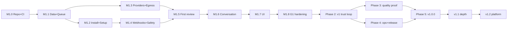

# Implementation plan (MVP → v1 → v1.1 → v1.2)

- Status: accepted plan, 2026-11-16. Implementation starts only when the owner says go (AGENTS.md).
- Inputs: accepted ADRs 0001–0026; [`../architecture/technical-approach.md`](../architecture/technical-approach.md);
  [`../product/capabilities.md`](../product/capabilities.md) release tiers; [`quality-gates.md`](quality-gates.md).
- Unit of work: one **work package (WP)** is one feature branch and one PR (sometimes 2–3 small PRs),
  each leaving `pnpm check` green. IDs are stable; reference them in branch names (`feat/wp-1-05-…`).
- Sizes are relative effort (S ≈ ≤ 2 days, M ≈ 3–5, L ≈ 6–10 working days for one developer plus agents).
  They are for sequencing, not promises.

---

## 0. How to read and run this plan

1. Work packages run **in order inside a milestone** unless they are marked ∥ (parallel-safe).
2. A milestone closes only when its **exit evidence** exists and the matching gate rows in
   `quality-gates.md` are ticked, with links to that evidence.
3. Every WP follows the same loop: **spec check → tests first for `domain` logic → implement →
   docs updated in the same PR → security notes for new boundaries → status.md updated**.
4. If a WP shows that an accepted doc is wrong, stop, write a superseding ADR or amend the spec, and
   only then continue (AGENTS.md "stop on contradiction").
5. The cut order and the "never cut" list in `capabilities.md` apply to the v1 scope.

### Critical path at a glance

---

## Phase 1b — Walking skeleton (MVP, gate G1)

**Goal:** an operator installs on a clean host, connects GitHub and a provider, triggers a review,
replies, gets a second answer, and resolves in `suggest`. All of it is safe against abuse on public
repos.

### M1.0 — Repository and CI

| WP | Title | Size | Contents | Done when |
| -- | ----- | ---- | -------- | --------- |
| 1-01 | Workspace skeleton | S | pnpm workspace; layout per approach §4; `tsconfig` base (TS 7 + 5.x fallback job); Biome; `.editorconfig`; LF/UTF-8 | `pnpm install && pnpm check` passes on an empty skeleton |
| 1-02 | Dependency-rule lint | S | Import boundaries (`domain` → `contracts` only; apps wire ports) via Biome/`dependency-cruiser` | A violating import fails CI |
| 1-03 | Test harness | S | vitest workspaces, fast-check, testcontainers Postgres helper, coverage thresholds (`domain` ≥ 90 % branches) | Sample tests run in CI on Linux amd64 |
| 1-04 | Licence and supply chain | S | Licence allowlist check, Renovate config, pinned versions verified live (the remaining tools in approach §13) | A BSL/SSPL test dependency fails CI |
| 1-05 | CI pipeline | S | GitHub Actions: PR check stages (approach §18), cache, multi-arch build (no push) | Green PR on `feat/walking-skeleton` |
| 1-06 | Spike S-A (queue) ∥ | S | graphile-worker serialization and debounce under concurrency; pg-boss adapter proof. **Done 2026-11-28** ([result](../analysis/spikes/2026-11-28-queue-serialization-debounce.md)): criterion met, graphile-worker stays, no ADR amendment; Q-051 and Q-052 opened and closed the same day (a licence exception; ADR-0037) | Written result in `docs/analysis/spikes/` |
| 1-07 | Spike S-C (structured output) ∥ | S | `ai` SDK structured output across OpenAI-compatible, Anthropic, and Ollama; measure the repair rate. **Partly done 2026-11-27** (CommandCode, both API formats; [result](../analysis/spikes/2026-11-27-commandcode-structured-output.md)); **closed 2026-11-28** by owner decision: the OpenAI-compatible result freezes the gateway interface; Ollama and a Claude model are skipped for now, and the capability probe (WP 1-19a) covers each provider at bind time | Written result; gateway interface frozen |

**Exit evidence:** a CI run link; both spike notes; ADR amendments if a spike failed.

**Progress (2026-11-27):** WP 1-01 to 1-05 are merged into `dev` (PR #5). CI evidence:
[run 46020023291](https://github.com/PrakashSewani/jury-forge/actions/runs/46020023291), all three
jobs green, including the testcontainers PostgreSQL integration test (see [`status.md`](status.md)).
Still open: spike 1-06 (1-07 closed 2026-11-28). The image build and size gate in 1-05
move to M1.2, when there is a Dockerfile to build; CI covers linux/amd64 and linux/arm64 with
typecheck and unit tests until then.

**Progress (2026-11-28):** spike 1-06 (S-A) is done, so the M1.0 exit evidence is complete: the CI
run above, the [S-A note](../analysis/spikes/2026-11-28-queue-serialization-debounce.md), and the
[S-C note](../analysis/spikes/2026-11-27-commandcode-structured-output.md). Neither spike failed its
criterion, so no ADR is amended.

### M1.1 — Data layer and queue

| WP | Title | Size | Contents | Done when |
| -- | ----- | ---- | -------- | --------- |
| 1-08 | Migrations v0 | M | SQL migrations for the MVP schema (approach §17); `org_id NOT NULL` and composite tenant foreign keys on every tenant-owned table, and the unclaimed instance org row (ADR-0035); `migrate` entrypoint; up/down tests | Fresh DB → latest → down → up in CI; a test fails if a non-exempt table lacks a non-null `org_id` |
| 1-09 | Store package | M | Kysely codegen; repositories with mandatory `org_id`; UUIDv7; audit append-only trigger; artefacts with expiry | Cross-tenant tests pass, including a database-level case: a child row that points at another org's parent is rejected |
| 1-10 | `JobQueue` port | M | graphile-worker adapter: `enqueue`, `enqueueTx`, `cancel`, `schedule`, `onJob`; per-session `queue_name`; `job_key` debounce; cron registry; a two-worker cron test (audit Q-E, [`job-pipeline.md`](../architecture/job-pipeline.md)) | Serialization, debounce, and txn-enqueue tests pass; with two `worker` processes, each cron tick fires exactly once (until this passes, only one `worker` replica is documented as safe) |
| 1-11 | Step runner core | M | `turn_steps` persistence, `(turn_id, step)` idempotency, generation check, `superseded` abort, retry policy | Fault-injection test: kill mid-step → resumes without duplicate effects |

**Progress (2026-11-28): WP 1-08 is written.** Five SQL migrations in `packages/store/migrations/`
create the 30 MVP tables (technical-approach §17 plus `worker_heartbeats`), the `uuid_v7()` id
function, and the unclaimed instance org. `migrate()` in the store runs them, and
`apps/server/src/migrate.ts` is the entrypoint. Integration tests on PostgreSQL 17:
- fresh → latest → all down → up gives an identical schema, and one-at-a-time down works;
- a non-exempt table without a non-null `org_id` that references `orgs` fails the check, as does a
  tenant foreign key that is not composite on `org_id` (each check has a negative case);
- a cross-tenant child row is rejected;
- deleting an org removes its rows in every tenant table and nothing else;
- the entrypoint reads `DATABASE_URL_FILE` and never prints the password.

The audit append-only trigger and the store's own UUIDv7 generation stay in WP 1-09.

**Progress (2026-11-28): WP 1-09 is written.** Its three scope decisions (owner, 2026-11-28):
- the generated types are checked in, with a drift test (`AGENTS.md` exception);
- audit deletes need a named reason;
- the store is a tenant-scoped layer plus the artefact and audit repositories; the other
  repositories land with the features that use them.

What it contains:
- **Migration 0006**, the audit guard.
- **`db.generated.ts`** from kysely-codegen, with its drift test.
- **`createStore`**, with `forOrg`, `instance`, `transaction`, `allowAuditDelete`, and
  `deleteExpiredArtefacts`.
- **The repositories** `putArtefact`/`getArtefact` and `appendAudit`.

UUIDv7 stays the SQL default only, so there is one generator. The Q-051 `argparse` exception landed
here, because kysely-codegen brings the same package.

**Progress (2026-11-28): WP 1-10 is written.**
- **The port** is `JobQueue` in `contracts` (where port interfaces now live). The adapter is
  `GraphileJobQueue` in `store`, with `start`, `stop`, `cleanup`, and `releaseDeadWorkers`.
  `migrate` also installs graphile-worker's schema.
- **Integration tests with worker processes:**
  - one job at a time per serial key, in order, across two workers;
  - 50 concurrent coalescing triggers become one run per key;
  - transactional enqueue: none on rollback, one after commit;
  - cancel;
  - each cron tick fires once with two worker processes (two consecutive ticks);
  - a graceful stop hands the aborted job to another worker (R3);
  - a killed worker's locks are released once its heartbeat is silent, and the session resumes in
    order;
  - a live worker with a silent heartbeat is fenced and exits before its job runs elsewhere;
  - queue cleanup (R6).
- **As built, ADR-0037's release waits one heartbeat plus 5 s** between marking a pool and
  unlocking it, so a slow but live worker stops first. A fenced handler that still finishes throws
  instead of completing, because graphile-worker completes a job by id whoever holds it
  (`job-pipeline.md`).

**Progress (2026-11-28): WP 1-11 is written, so M1.1's four WPs are complete.**
- **The parts:**
  - `runTurn` in `pipeline`, over the `TurnStore` port in `contracts`;
  - `createTurnStore` in `store`;
  - `canonicalJson` (step input hashes) and `decideFailure` (the retry policy) in `domain`, at 100%
    branch coverage.
- **Behaviour:** `(turn_id, step)` idempotency with first write wins, a generation check before
  every step, the `superseded` abort, older unfinished turns closed at start (R2), and the abort
  signal honoured at step boundaries and passed to each step (R4).
- **The exit test** (`apps/server`): a worker killed inside a step; another worker resumes the turn
  through the ADR-0037 release; finished steps are not run again and no effect is duplicated.
- **Left for M1.5:** the `resolve` step that reads pending inputs (R1; payloads already carry ids
  only), and steps that stop within 5 s of the abort (R4).

**Carried from spike S-A and the decisions it led to.** The owner closed both S-A questions on
2026-11-28. The recommendations R1–R9 are not decided; each WP settles its own.

- **WP 1-08:** the `worker_heartbeats` table, and its place in the migration test's list of tables
  without `org_id` (ADR-0037).
- **WP 1-10 (done 2026-11-28):** the `argparse` exception (landed in WP 1-09); the ADR-0037
  heartbeat, fencing, and release with both tests; complete and fail writes awaited on shutdown (R3)
  with a graceful-stop test; `maxAttempts` explicit (R7); `GraphileJobQueue.cleanup()` (R6; the
  retention cron that calls it is WP 1-28a); the debounce bound written down (R8, `job-pipeline.md`).
- **WP 1-11 (done 2026-11-28):** orphaned turns are closed when a turn starts (R2), and the runner
  honours and passes on the abort signal (R4). Still open for M1.5: `resolve` reads the pending inputs
  (R1), and each step stops within 5 s of the abort (R4).
- **WP 1-13 (done 2026-11-28):** the `worker` stop grace period is 15 s, above graphile-worker's
  5 s abort timeout (R4).
- **WP 1-14:** both TLS modes of [ADR-0036](../decisions/ADR-0036-tls-terminated-in-front.md),
  `caddy` and `front`, with `first-run-setup` criterion 23; the `front` path is first run on the
  owner's VPS behind a Cloudflare Tunnel (`deployment.md` §4 C1).
- **WP 1-28a:** the stuck-turn sweep calls `releaseDeadWorkers` and writes the `queue.lock_released`
  audit event; the retention cron calls `GraphileJobQueue.cleanup()`.

### M1.2 — Install and setup

| WP | Title | Size | Contents | Done when |
| -- | ----- | ---- | -------- | --------- |
| 1-12 | Image | M | Multi-stage distroless image, non-root, read-only root FS, amd64/arm64; **spike S-B** (tree-sitter WASM on distroless/arm64) | Image ≤ 250 MB; S-B note written |
| 1-13 | Compose bundle | M | `compose.yaml` (caddy, migrate, app, worker, postgres), healthchecks, loopback `SETUP_BIND`, volumes, `.env.example` | `docker compose up` healthy on a clean VM |
| 1-14 | Caddy and origin | M | On-demand TLS with an `ask` endpoint; the origin step (ADR-0021); `PUBLIC_URL` freeze | A valid certificate for the configured domain; others refused |
| 1-15 | Bootstrap and crypto | M | KEK file loading; envelope encryption (`crypto` package); bootstrap token; setup state machine | Unit + integration tests; the key never appears in logs |
| 1-16 | GitHub App and OAuth | L | App manifest flow, installation callback, verify-before-claim, OAuth login, first-owner claim, user sessions (hashed, cookie flags), CSRF | Clean-VM setup reaches "claimed" |
| 1-17 | CLI v0 ∥ | S | Bash `jury-forge`: `install`, `setup domain`, `doctor` (DB, migrations, queue, App auth, clock, disk, KEK) | `doctor` catches seeded faults |

**Progress (2026-11-28): WP 1-12 is written.**
- **The image:** the `Dockerfile` builds onto distroless Node 24 (Debian 13, `nonroot`), with both
  bases pinned by multi-arch digest. Its entrypoint is `node /app/dist/main.js <command>`, and it
  holds plain JS emitted by `pnpm run build`.
- **Size,** as the unpacked root filesystem: 207.6 MB on amd64 and 213.5 MB on arm64, against the
  250 MB gate.
- **Checks:** `migrate` runs as `nonroot` with a read-only root filesystem and all capabilities
  dropped, on both architectures (arm64 under QEMU locally). The CI `image` job builds natively on
  amd64 and arm64, applies the size gate, and runs that smoke test.
- **Renovate** regex managers keep the base-image digests and the CI `postgres` tag current.
- **Spike S-B is done** ([note](../analysis/spikes/2026-11-28-tree-sitter-distroless.md)): distroless
  stays.
- **Carried forward:**
  - to the `parsing` WP (v1, T0+): ship only the grammar `.wasm` files, measure arm64 natively, and
    bound the worker pool (S-B R1–R3);
  - before T0+: remove the 31 MB `typescript` optional peer from the image (S-B R4).
- **Also moved here from WP 1-05:** the image build and size gate.

**Progress (2026-11-28): WP 1-13 is written.**
- **The bundle:** `deploy/` holds `compose.yaml`, `Caddyfile`, `.env.example`, and
  `init-secrets.sh`. `deployment.md` §3 ("The bundle as built") lists where it differs from the
  illustrative shape: three networks, secret ownership, users, probes, and the stop grace.
- **The roles,** in the image:
  - `app`: Fastify with `/healthz` and `/readyz` (database, migrations at head, queue schema; 503
    with a breakdown and no error text), plus the setup listener on `SETUP_BIND` with `/healthz`;
  - `worker`: the queue with its ADR-0037 heartbeat; exit 0 on `SIGTERM`, exit 1 when fenced;
  - `healthcheck <url>`: loopback HTTP only.
- **Image size:** 217.9 MB on amd64 with Fastify and pino, against the 250 MB gate.
- **The exit check:** `scripts/compose-smoke-test.sh`. CI runs it on fresh amd64 and arm64 runner
  VMs in the `image` job. It checks:
  - first start healthy, and `migrate` exit 0;
  - hardening on all five containers;
  - setup on host loopback only;
  - `:80` redirects, and `:443` issues no certificate;
  - postgres and port 3000 not published, and no egress on `internal`;
  - a clean worker stop;
  - `down` and `up` with 0 migrations.

  A mutation run (setup published on `0.0.0.0`) fails it as expected.
- **Tests:** `checkReadiness` (5 integration tests); the role tests (3 integration tests:
  readiness before and after `migrate`, the heartbeat, fencing); and unit tests for the listen
  address, the environment, the logger, HTTP, and the healthcheck.
- **Carried forward:**
  - **WP 1-14 (done 2026-11-28):** `/readyz` reports the origin state in its body without failing
    readiness (owner decision); the `ask` endpoint. Caddy 2.11 has no `interval`/`burst`
    (ADR-0038). `TRUSTED_PROXIES` moved to WP 1-15, and the `front` variant files to WP 1-16.
  - **WP 1-15:** the master key secret file, its `/readyz` component, and the zod environment
    schema in `contracts` (technical-approach §14). WP 1-13 parses its three variables by hand.
  - **WP 1-17:** `jury-forge init` replaces `init-secrets.sh`, including the file ownership.
  - **WP 4-05:** digest-pinned published images replace `build:` in `compose.yaml`.
  - **Open, not owned by a WP yet:**
    - TLS to the bundled Postgres; the connection stays on the `internal` network;
    - a least-privilege database role for `app` and `worker`; today all three roles connect as
      `jury_forge`, the cluster's owner;
    - user-namespace-remapped and rootless Docker (secret uids).

**Progress (2026-11-28): WP 1-14 is written, split by the owner.** The origin step sits behind the
bootstrap token (WP 1-15), and the `front` proof needs the App (WP 1-16). So WP 1-14 builds the
origin plumbing, and the origin is set only by `PUBLIC_URL` until WP 1-15.
- **Built:**
  - `parseOrigin` with typed reasons, and a token bucket (`domain`, 100% branch coverage);
  - the stored origin with compare-and-set and audit (`store`);
  - `OriginService`, the `ask` endpoint, `Host` pinning (`421`, and `503 origin_unset`), and the
    `PUBLIC_URL` freeze;
  - both TLS modes and their readiness states, and the TLS handshake check (`apps/server`).

  `deployment.md` §3 ("The origin and TLS as built") has the details.
- **Owner decisions (2026-11-28):**
  - the split above;
  - `/readyz` keeps its status code for the process's dependencies, with the origin state in the
    body;
  - the issuance check is a handshake to Caddy;
  - Pebble in CI proves the exit.
- **ADR-0038 (proposed):** the issuance limit is the app's alone, 5 per 2 minutes, because Caddy
  2.11 refuses `interval`.
- **The exit:** `scripts/compose-smoke-test.sh` phase 2, with `PUBLIC_URL` set and Caddy pointed at
  Pebble:
  - the configured name gets a valid certificate, and another name fails the handshake;
  - another `Host` gets `421`, and internal paths answer `404` from outside;
  - `/readyz` reports `tls_issued`.
- **Carried forward:**
  - **WP 1-15:** the Stage 1.5 setup route behind the bootstrap token. It uses `parseOrigin`,
    `writeOriginSetting`, and `OriginService.invalidate()`, and adds:
    - pre-save DNS and port validation;
    - the "I terminate TLS in front" confirmation (it sets `front`);
    - `TRUSTED_PROXIES`, for the token's per-IP limit;
    - the read-only origin field when `PUBLIC_URL` freezes it.
  - **WP 1-16:**
    - the ADR-0036 proof, a verified delivery plus `insecure_ssl` = 0, which makes `tls_front`;
    - `PATCH /app` and re-login on an origin change, and the 3-changes-per-hour cap;
    - the `front` deployment files for the owner's VPS (Caddy on plain HTTP, no published ports).
  - **WP 1-17:** `doctor` reports the origin, the mode, and the `ask` refusals.

### M1.3 — Providers and egress

| WP | Title | Size | Contents | Done when |
| -- | ----- | ---- | -------- | --------- |
| 1-18 | Egress module | M | `undici` dispatcher: allowlist, DNS re-check, private-range block, redirect re-check, size and time caps, `HTTPS_PROXY` | SSRF corpus passes |
| 1-19 | Provider onboarding | M | Add/verify key (write-only, encrypted, origin-bound), `/models` discovery, catalog + registry enrichment, refresh, deprecation | No free-text model; an invalid key stores nothing |
| 1-19a | Capability probe | M | Auth check by authenticated call; structured-output modes on synthetic fixtures; budget + estimate; `model_probes`; re-probe triggers; binding gate (ADR-0029) | A model with no passing mode cannot be bound; a bad key fails even where `/models` is public |
| 1-20 | Gateway `complete()` | M | `ai` SDK inside; zod → structured output in the probe-chosen mode; one repair attempt (prompt mode only); `finish=length` fails; per-provider token bucket; hard caps; redacted I/O persisted | Contract tests per provider kind with recorded fixtures |
| 1-21 | Stub provider ∥ | S | Deterministic scripted provider in `testkit`; `pnpm dev:stub` | The full pipeline runs offline |
| 1-22 | Secret redaction | M | gitleaks-derived ruleset, entropy check, placeholders, per-rule tests, counts recorded | Redaction corpus passes; no secret reaches the gateway |

### M1.4 — Webhooks and safety core

| WP | Title | Size | Contents | Done when |
| -- | ----- | ---- | -------- | --------- |
| 1-23 | Webhook ingest | M | Raw-body HMAC, age check, `webhook_deliveries` dedup, event → intent mapping, persist + enqueue in one txn, 202 in < 300 ms p99 | Fixture replay tests; duplicate delivery → one job |
| 1-24 | Forge adapter | L | `ForgeAdapter` port; GitHub implementation (installation tokens, diff, contents at SHA, checks, reviews, comments, thread GraphQL); **spike S-D**; contract suite | The adapter passes the contract suite against fixtures |
| 1-25 | Write queue | S | `publish.github` per-installation queue, ≤ 1 mutation/s, `Retry-After`, secondary-limit backoff, `external_id` idempotency | Publish-then-crash test: no duplicate review |
| 1-26 | ADR-0024 safety core | M | Trigger authz (`author_association`), self-detection by App ID, bot/fork skip, per-thread/session/user turn budgets, hand-off message | Abuse corpus: non-collaborator, bot, self, and fork start no turn |
| 1-26a | Router, bindings, and fallback | M | `reviewer_repo_bindings` for the one built-in reviewer (`required`/`default`; ADR-0013, ADR-0016); the router steps of `agentic-review-sessions` §6 (MVP subset: binding, availability, budget); the reason each reviewer ran or was skipped recorded in the timeline; no runnable reviewer → the configuration or required-unavailable fallback, never a clean review (`review-progress-and-completion` §1 and §5) | No binding → `action_required` fallback and no turn; an unavailable required reviewer → no review; the timeline shows why |
| 1-27 | Check Run lifecycle | S | `queued → in_progress → completed`, actions (`review`), failure reasons, placeholder comment option | Matches the review-progress spec |
| 1-28 | Reconciler cron ∥ | S | Every 10 min: open PRs with a pending `jury:pr-review` label, enqueue what was missed. Built in the MVP ahead of its v1 capability row; the PR-checkbox trigger is v1 (WP 2-32) | A delivery dropped during downtime is recovered |
| 1-28a | MVP maintenance crons ∥ | S | The MVP cron jobs of technical-approach §3.3 not covered elsewhere: **stuck-turn sweep** (every 5 min; a turn `running` > 20 min, configurable, fails as `stuck` and its Check Run completes under the RP-03 failure rules), **catalog refresh** (daily, staggered per provider; a removed model marks its reviewer `configuration_error` and never switches a binding), and **retention** (daily; deletes expired `artefacts`) | A seeded stuck turn is failed and its Check Run completed; a model removed from a fixture `/models` disables its reviewer; an expired artefact is deleted |

### M1.5 — First review

| WP | Title | Size | Contents | Done when |
| -- | ----- | ---- | -------- | --------- |
| 1-29 | Fetch and instructions | M | Diff at head; base-SHA instruction files (S11 set, capped, trust-labelled); base-SHA `.jury-forge.yml` parse and validate | A PR that changes the instruction files is flagged; head edits are ignored |
| 1-30 | Plan: fitting + coverage | M | Exclusion list, language priority, additions before deletions, token-aware fitting, coverage manifest, first-line partial note | Large-PR corpus: nothing silently dropped |
| 1-31 | Prompt builder | M | Prompt files (approach §16), fixed cache-friendly order, nonce-delimited untrusted blocks, hash recording | Injection corpus v0 does not change the output |
| 1-32 | Juror step (1 reviewer) | M | Built-in Correctness juror; output schema; per-turn caps | Stub eval passes; a real PR gets findings |
| 1-33 | Ground + fingerprint | M | File/line/quote checks at the SHA; `anchor_hash`; fingerprint (ADR-0024 §4); recurrence suppression on the same PR | Property tests: fingerprints stable under whitespace changes |
| 1-34 | Publish | M | Single review + inline comments within forge limits, compact provenance, coverage line, Check Run completion | A real review on a test repo; idempotent on retry |

### M1.6 — Conversation

| WP | Title | Size | Contents | Done when |
| -- | ----- | ---- | -------- | --------- |
| 1-35 | Message versions | S | Store comment versions; a turn answers the version it read | An edit after the read creates a new version |
| 1-36 | Reply turn | M | Debounced reply → answer from the originating juror; prior agent output labelled advisory; loop budgets | Reply → second response demo |
| 1-37 | `suggest` resolution + sync | M | Proposed-resolution text; GraphQL `isResolved` sync on each turn and in the reconciler; a reply reopens | A native GitHub resolve updates the finding |
| 1-38 | Feedback | S | One-click valid / wrong / fixed / duplicate (UI + API), audited | Recorded and visible in the timeline |
| 1-39 | Push handling (basic) | S | `synchronize` → generation++, cancel stale jobs, findings `needs_recheck` (the full re-anchor comes in v1) | A stale turn never publishes |

### M1.7 — UI

| WP | Title | Size | Contents | Done when |
| -- | ----- | ---- | -------- | --------- |
| 1-40 | UI shell | M | Vite + React + TanStack, design tokens, layout, auth guard, error taxonomy mapping, command palette | Playwright smoke + axe clean |
| 1-41 | Setup and providers pages | M | Setup wizard (origin → App → claim → provider → reviewer), provider catalog | Clean-VM run is UI-only |
| 1-42 | Sessions list and detail | M | Inbox; detail timeline (trigger, steps, findings, replies, resolution), coverage panel, cost strip | Matches the v1-ui spec subset |
| 1-43 | Settings and reviewer | S | Caps, retention, the one reviewer's model and instructions, "Try on a PR" (no publish) | Audited changes |

### M1.8 — G1 hardening

| WP | Title | Size | Contents | Done when |
| -- | ----- | ---- | -------- | --------- |
| 1-44 | Eval harness v0 | M | ≈ 20 labelled fixture PRs (bugs, clean, adversarial) on the stub model in CI; regression blocking | Required check on every PR |
| 1-45 | Fault injection | S | Duplicate, crash, publish-then-fail, cancel, superseded generation | All pass |
| 1-46 | Clean-machine install test | S | Scripted VM run; timings recorded (median target ≤ 15 min) | Install log in evidence |
| 1-47 | Operator docs v0 | S | Install, setup, troubleshooting, security notes, `doctor` output reference | Docs reviewed against the real run |
| 1-48 | **G1 review** | S | Tick the G1 rows with links; status.md; tag `v0.1.0-mvp` (pre-release) | The owner signs G1 |

**MVP done = G1 passed.**

---

## Phase 2 — The trust loop (v1 features, gate G2)

Ordered so each theme builds on the previous one. Themes match the v1 tier groups.

### M2.1 — Jury and pipeline (ADR-0025)

| WP | Title | Size | Contents |
| -- | ----- | ---- | -------- |
| 2-01 | Model roles | S | Instance `reasoning`/`fast` bindings; per-reviewer override; settings UI |
| 2-02 | Three jurors | M | Security, Correctness, Tests prompt files; parallel review bounded by the provider bucket |
| 2-03 | T0+ expansion | M | tree-sitter enclosing-unit queries for 8 grammars, worker-thread pool, timeouts, ±20 fallback, recorded in the coverage manifest |
| 2-04 | Verifier | M | Non-voting verify step; `confirmed/unconfirmed/wrong`; drop/collapse rules; metrics |
| 2-05 | Code-only chair | M | Fingerprint merge, highest confirmed severity capped by policy, agreement ratio, ranking, dissent text by the `fast` model |
| 2-06 | Presets + estimate | S | `quick/standard/deep`, the 6-step resolution order, pre-run estimate in the Check Run |
| 2-07 | Evidence ingest ∥ | M | Linked issue + CI SARIF from check runs as trust-labelled evidence |

### M2.2 — Conversation (rest of ADR-0024 + S1/S2)

| WP | Title | Size | Contents |
| -- | ----- | ---- | -------- |
| 2-08 | Re-anchoring | L | Exact-then-fuzzy anchor match, `fix_candidate`/`outdated`, re-anchor corpus (rebase, rename, reformat, force-push) |
| 2-09 | Recheck + verified fixed | M | Cheap recheck turn per changed thread; "Verified fixed in `<sha>`" / "Still present" |
| 2-10 | Incremental review | M | New-commits-only diff when a trigger is active; never repeats open findings |
| 2-11 | Reply intent + appeal | M | `fast` intent classifier; appeal flow (originating juror + one other, then the verifier, then code decides); one appeal per finding |
| 2-12 | `auto` guard | S | ADR-0024 §6 conditions; reversible; wrong-resolution metric |
| 2-13 | Enforced budgets | M | Session/repo/installation/requester budgets that fail closed; Check Run reason; owner notice |
| 2-14 | Stalled sessions ∥ | S | Hourly cron: 7-day `needs human` flag and one nudge, 30-day drop from the default inbox; archive only on PR merge/close (`session-capacity-and-visibility` §2) |

### M2.3 — Output

| WP | Title | Size | Contents |
| -- | ----- | ---- | -------- |
| 2-15 | Comment ceiling + withheld count | S | ADR-0033: fixed 50-comment safety ceiling (code constant), optional `review.max_inline_comments` repo cap, `critical` always inline, overflow in a collapsed section, withheld count in the summary, ceiling-hit metric |
| 2-16 | Risk score | S | Deterministic factors (paths, size, max severity, disagreement); shown in the Check Run; inbox sort |
| 2-17 | Jury charges | M | `.jury-forge.yml` charges → Check Run line items with evidence |
| 2-18 | Suggestion blocks | M | Single-hunk GitHub `suggestion` validated to apply cleanly at the SHA |
| 2-19 | Fix-prompt handoff ∥ | S | Per-finding and "all open" fix prompts |
| 2-20 | Merge-gate policy | S | Check Run conclusion policy: `neutral` / `critical` / `charges` |
| 2-21 | PR summary ∥ | S | 3-line summary by the `fast` model in the review body |

### M2.4 — Learning

| WP | Title | Size | Contents |
| -- | ----- | ---- | -------- |
| 2-22 | Reaction feedback | S | Poll 👍/👎 from write-access users (5 min, open sessions) |
| 2-23 | Implicit acceptance | S | A finding fixed in a later commit counts as accepted |
| 2-24 | Repo memory | M | Suppressions (never `critical`, 90-day expiry), human-confirmed facts from appeals, Memory UI |
| 2-25 | Per-juror scorecard | S | Posted/accepted/wrong/appealed table per juror and rule |

### M2.5 — Trust

| WP | Title | Size | Contents |
| -- | ----- | ---- | -------- |
| 2-26 | Receipt v1 | M | Full receipt fields (jury-output spec), JCS, Ed25519, hash chain, public-key endpoint, download |
| 2-27 | Offline verifier | S | `jury-forge receipt verify` (Node script, `@noble/ed25519`); tamper and deletion tests |
| 2-28 | Egress preview | S | Exact redacted payload preview per repo before the first call |
| 2-29 | Roles | M | owner/maintainer/reader enforced server-side; an authz test per mutating route generated from the route table |
| 2-30 | Retention + audit export | M | 30-day raw / 1-year findings and receipts, per-repo purge, JSONL export, optional syslog/OTLP sink |
| 2-31 | Injection corpus v1 | M | Diff, reply, edited comment, instruction file, linked issue, SARIF, pack; a release gate |

### M2.6 — Ops (v1)

| WP | Title | Size | Contents |
| -- | ----- | ---- | -------- |
| 2-32 | PR-checkbox trigger ∥ | S | Detect the checked box in the PR body; reconciler covers missed edits |
| 2-33 | Bot-author defaults ∥ | S | `authors.exclude` defaults (dependabot, renovate) |
| 2-34 | Conventions pack (one) | S | One org pack, versioned, cited `slug@hash` |
| 2-35 | **G2 review** | S | Red team (internal), tick G2, tag `v0.5.0-beta` |

---

## Phase 3 — Quality proof (gate G3)

| WP | Title | Size | Contents |
| -- | ----- | ---- | -------- |
| 3-01 | Dogfood | S | Run Jury Forge on its own repo for every PR from this point |
| 3-02 | Pilot repos | S | 2–3 consenting repos (OSS or friendly teams); data-handling agreement written |
| 3-03 | Replay tool (internal) | M | Re-run stored turn inputs against another model or preset without posting (the public UI arrives in v1.1) |
| 3-04 | Baseline comparison | M | Jury vs a single strong model at **equal token budget**; precision from feedback/appeals, recall from human review comments and later fixes |
| 3-05 | Calibration | M | Confidence buckets vs acceptance; tune the verifier threshold, the comment ceiling, and chair parameters (as code constants with ADR notes) |
| 3-06 | Cost and latency report | S | Cost per accepted finding, p50/p95 latency per preset; publish the ranges in the docs |
| 3-07 | Branch-review decision | S | Record whether T0+ recall is enough, or whether branch review leads v1.1 |
| 3-08 | **G3 review** | S | Scorecard, dogfood report, method published |

---

## Phase 4 — Operations and release (gate G4) ∥ with Phase 3

| WP | Title | Size | Contents |
| -- | ----- | ---- | -------- |
| 4-01 | Backup/restore | M | `backup` (DB + optional key), `restore` with a key prompt, a drill that verifies the receipt chain |
| 4-02 | Upgrade/rollback | M | N-1 → N with seeded data, rollback, pre-upgrade automatic backup; nightly drill |
| 4-03 | Observability pack | M | `/metrics` complete, Grafana dashboard JSON, alert rules, SLO doc |
| 4-04 | Support bundle | S | Redacted bundle via the CLI |
| 4-05 | Release pipeline | M | SBOM, cosign keyless, SLSA provenance, minisign bundle, changelog automation |
| 4-06 | Load/soak + sizing | M | Footprint budgets (approach §6) verified; sizing table for 5/50/200 devs published |
| 4-07 | Docs complete | M | Install, upgrade, backup, security model, troubleshooting, runbooks, `.jury-forge.yml` reference |
| 4-08 | Community files ∥ | S | `CODE_OF_CONDUCT.md`, issue/PR templates, governance note |
| 4-09 | **G4 review** | S | Drills, signed digests, docs review |

## Phase 5 — v1.0.0 launch (gate G5)

| WP | Title | Size | Contents |
| -- | ----- | ---- | -------- |
| 5-01 | Release candidate | S | `v1.0.0-rc.N`; external dogfood team for 2 weeks |
| 5-02 | Security review | M | External or community review; no open S1/S2 |
| 5-03 | Launch assets | S | Docs site, read-only demo instance (no customer code), public scorecard, comparison page (facts only) |
| 5-04 | **G5 + tag `v1.0.0`** | S | Owner sign-off |

---

## v1.1 — Depth (after v1.0.0)

| WP | Title | Size | Contents |
| -- | ----- | ---- | -------- |
| 11-01 | Replay UI + public scorecard | M | Operator-facing replay (no posting), comparison views |
| 11-02 | Git fetch at SHA | M | Git client in the image, sparse/partial clone, cache, retention |
| 11-03 | Callers index | L | tree-sitter symbol extraction, callers-of-changed-symbols in Postgres adjacency tables |
| 11-04 | Branch review (T2) | L | `jury:branch-review`, estimate/cancel, tool-calling jurors through the gateway, coverage manifest |
| 11-05 | Full graph (gated) | L | Only if 3-07/11-04 data justifies it (ADR-0014) |
| 11-06 | Analyzer sandbox | L | **New ADR first**; no-network read-only container; pinned analyzers; results as evidence |
| 11-07 | Provider fallback | S | Per-reviewer fallback model; recorded in the receipt |
| 11-08 | Skills + read-only MCP | M | `code-review` skill folder at base SHA; allowlisted MCP with egress logged |
| 11-09 | SARIF upload | S | Findings to code scanning |
| 11-10 | Rule auto-tuning suggestions | S | Suggest disabling low-acceptance rules (never auto-apply) |
| 11-11 | GHES | M | Configurable API base, GHES contract fixtures, docs |
| 11-12 | CLI `--staged` | M | Local diff review through the operator's instance (B-03) |

## v1.2 — Platform

| WP | Title | Size | Contents |
| -- | ----- | ---- | -------- |
| 12-01 | Reviewer catalog + studio + approval | L | ADR-0016 in full |
| 12-02 | Capability registry + `jury:cap:*` labels | L | Label sync to all repos, groups, disabled fallback |
| 12-03 | Wider roles | M | SME/admin/viewer/auditor; domain-scoped resolution |
| 12-04 | Knowledge system | L | Packs, doc links with snapshots and SSRF guards, grants, retrieval UI, signed packs (ADR-0017) |
| 12-05 | History-seeded conventions | M | Draft pack from human review history; approval |
| 12-06 | OIDC | M | Generic OIDC (Keycloak/Entra/Okta) alongside GitHub OAuth |
| 12-07 | Helm chart | L | ADR-0022 gates (`kind` e2e, `helm test`, values schema) |
| 12-08 | Provider allowlists / data zones | M | Per-repo provider policy (B-02) |
| 12-09 | Analytics UI + notifications | M | Trends; Slack/email/webhook with redaction |
| 12-10 | Object storage adapter | S | Optional S3-compatible artefacts |
| 12-11 | GitLab self-managed | L | Adapter against the forge contract suite |

---

## Cross-cutting tracks (run alongside every phase)

| Track | Rule |
| ----- | ---- |
| **Security** | Every WP that adds a route, egress, secret, or prompt input updates `security.md` and adds corpus cases. A threat-model refresh runs at each gate. |
| **Docs** | Behaviour changes update the spec and operator docs in the same PR. `status.md` is updated per merged WP. |
| **Quality** | The stub eval and corpora are required checks. Prompt changes need an eval pass and a changelog entry. |
| **Footprint** | The image size and idle-RAM gates run on `dev` merges. |
| **Licences** | The allowlist check is required, and every new grammar or dependency has its licence recorded. |

## Risks to the plan, and responses

| Risk | Early signal | Response |
| ---- | ------------ | -------- |
| v1 too big (R-039) | Phase 2 runs past 2× its estimate | Apply the cut order; ship `v1.0` without the cut items; they move to `v1.0.x` |
| Spike failure (S-A..S-E) | A spike misses its criterion | Switch to the documented fallback (pg-boss, slim image, bash CLI) and amend ADR-0026 |
| Re-anchoring accuracy (R-035) | Corpus pass rate < 95 % | Default doubtful anchors to `outdated`; never repost |
| Provider structured-output gaps | Repair rate > 5 % for a provider | Mark the provider "basic" in the catalog; restrict it to the `fast` role |
| GitHub API limits | Secondary-limit hits in soak | Lower the write rate; batch comments into the review body |

## Immediate next steps (when the owner says go)

1. Create the branch `feat/walking-skeleton` from `dev`.
2. WP 1-01 → 1-05 (M1.0), with spikes 1-06/1-07 in parallel.
3. Report the M1.0 exit evidence and spike results before M1.1.
